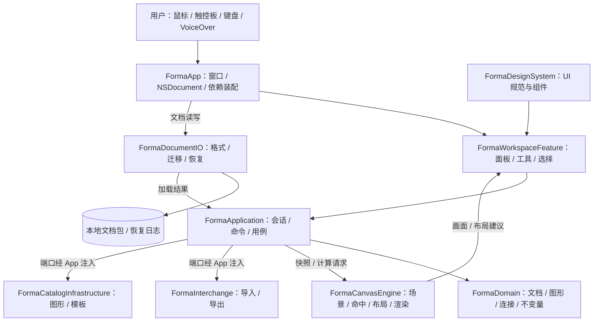
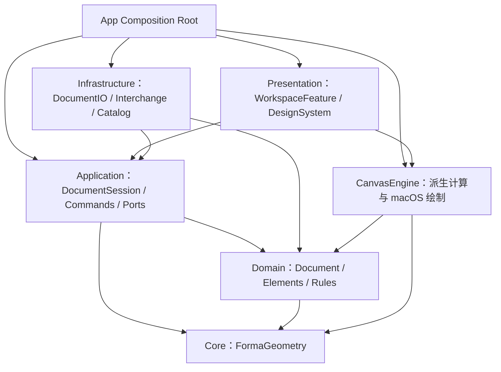
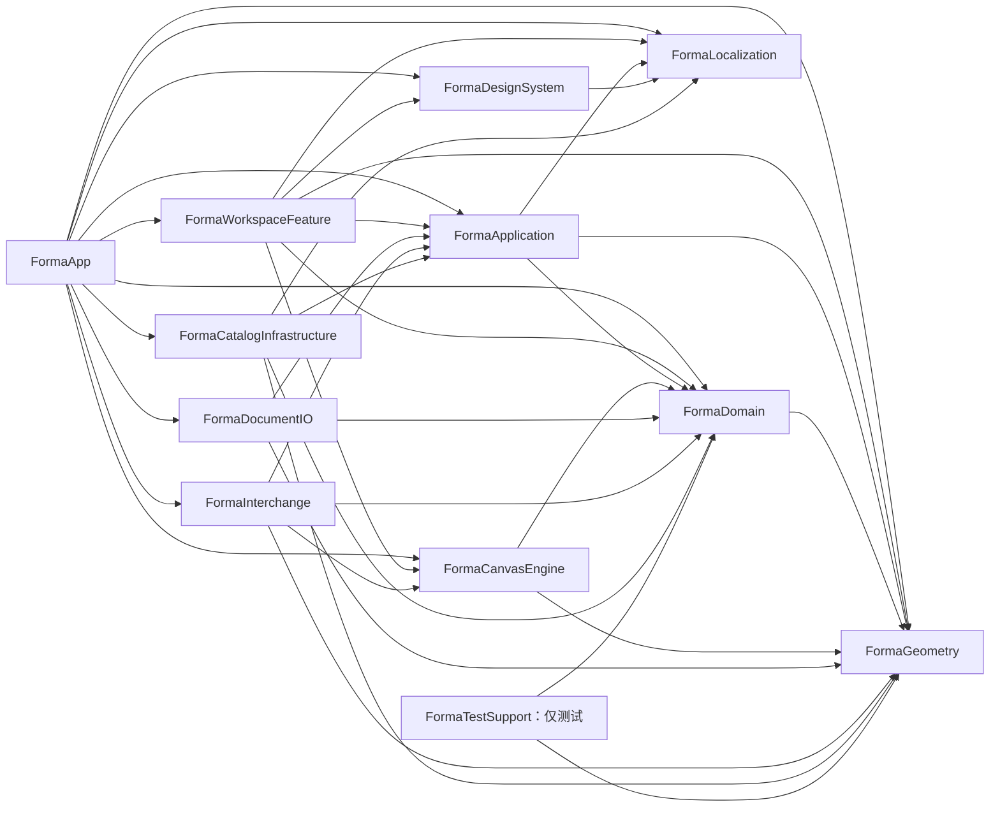
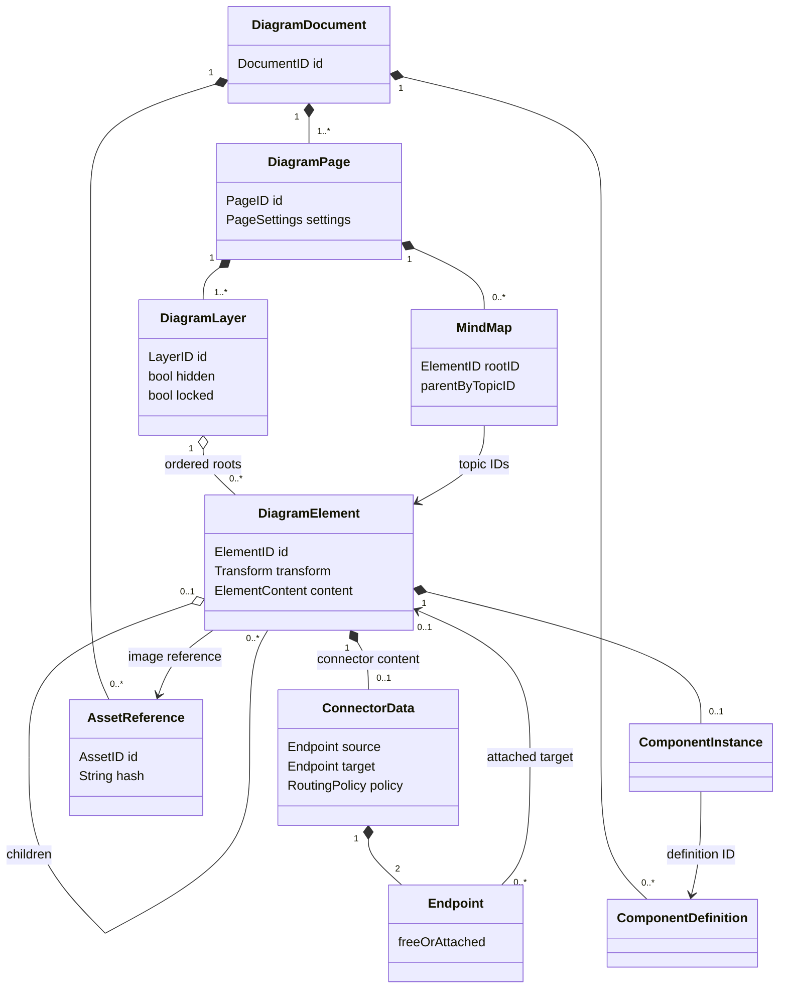
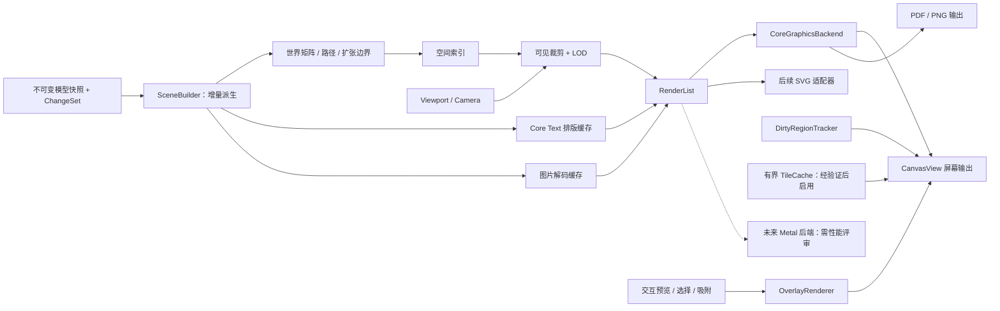
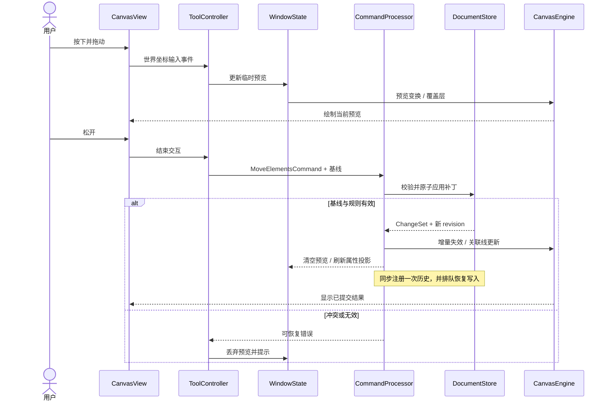
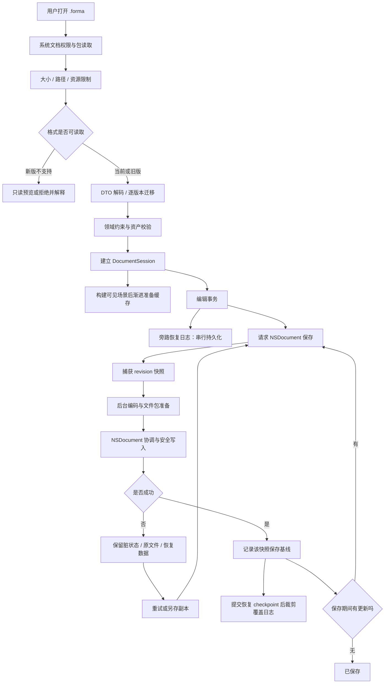
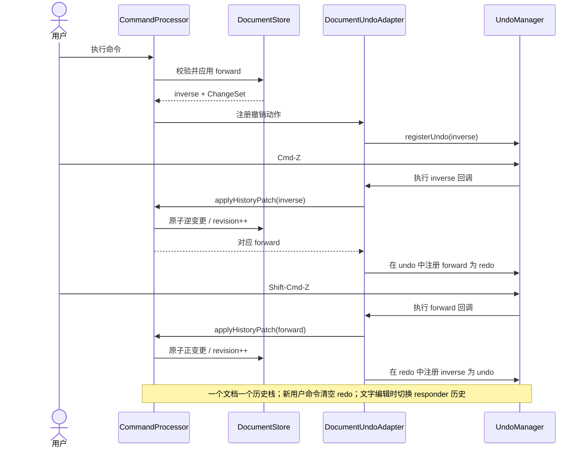

# Forma：高端 macOS 原生 Diagram 产品设计与技术架构方案

文档版本：1.0｜规划基准：2026-10-21｜项目状态：商业版目标规划；已启动实施，当前完成范围见 [开发里程碑](开发里程碑.md)。

Forma 为暂定产品名；商标、Bundle ID、文档类型标识及上架名称须在发布前核验。本文所有性能数字、工期和容量均为工程预算或验收目标，并非实测结论。本方案编制时目录尚无应用代码；现已有第一轮开发预览，本文中的完整功能和目录仍是目标架构，不代表全部实现。

本方案按“产品功能文档 → UI/UX 规范 → 技术栈 → 系统架构 → 架构图 → 项目目录结构 → 开发计划”组织。性能、安全与工程质量放入系统架构章节，作为架构实施要求。

## 一、产品功能设计文档

### 1.1 产品定位

**为专业人士提供离线可靠、交互精准、视觉精致的 Mac 图表工作台，将想法快速整理为可编辑、可交付的结构化图形。**

核心价值：比通用白板更有结构，比传统制图软件更易上手；专业能力通过渐进披露呈现，常用操作保持直接。商业方向为个人专业版与团队授权，具体价格、订阅或买断模式在用户研究后确定，不让账户、云端或付费校验成为本地文档读取的前置条件。

| 用户 | 高价值场景 | 关键需求 | 成功判据 |
|---|---|---|---|
| 软件架构师、工程师 | 系统架构、服务依赖、部署拓扑 | 稳定连线、对齐、分组、矢量导出 | 架构调整后连接关系保持正确 |
| 产品经理、业务分析师 | 流程、用户路径、状态流转 | 模板、快速创建、流程语义 | 从空白到一张可讨论的流程图低于 10 分钟 |
| 设计师、顾问 | 信息组织、演示交付 | 排版、一致样式、PDF/SVG | 导出后文字和线条清晰，布局可复现 |
| 教师、研究者、独立工作者 | 思维整理、课程结构 | 键盘建图、中文输入、离线 | 不依赖鼠标也能完成基本结构编辑 |

产品参考转化为设计原则：借鉴 Figma 的直接操控与属性一致性、FigJam 的低门槛、Whimsical 的快速建图、draw.io 的图形覆盖思路、OmniGraffle 的桌面专业工作流；这些是本项目设计方向，不承诺与其文件或功能完整兼容，也不复制其视觉资产。

### 1.2 产品边界与版本范围

优先级定义：P0 为 MVP 发布阻断项；P1 为正式版核心能力；P2 为后续增强。MVP 也必须包含错误处理、可访问性、自动保存和性能基线，不能作为发布后补丁。

| 范围 | MVP 0.1：可靠成图 | 正式版 1.0：专业交付 | 未来版本 |
|---|---|---|---|
| 画布 | 单页、无限平移、缩放、网格、吸附 | 多页、画框、缩略导航、演示 | 跨页引用、超大项目导航 |
| 制图 | 基础流程、基础架构、基础思维树 | 泳道、更多架构符号、思维分支折叠 | ER/UML 专用语义、数据驱动图 |
| 编辑 | 选择、缩放、旋转、文本、对齐、分组 | 高级排版、格式刷、样式令牌 | 路径布尔运算等按需求评估 |
| 连线 | 锚点绑定、直线、折线、箭头、标签 | 避障路由、曲线、自定义端口、跳线 | 专业布线约束与跨页连接 |
| 布局 | 简单树布局、思维树左右布局 | 分层 DAG、循环处理、受限自动布局 | 可插拔布局策略 |
| 资源 | 内置图形、6 个模板、本地图片 | 可复用组件、团队离线组件包、模板制作 | 经审核资源市场 |
| 文件 | 原生格式、PNG/PDF 导出、剪贴板 | SVG 子集导入导出、draw.io 子集导入 | 经验证的更多格式 |
| 协作 | 单机，多文档窗口 | 文件交付、版本与冲突副本 | 评论、实时协作、组织管理 |
| 工程 | 恢复、撤销、签名、公证、基本无障碍 | 长期兼容、专项性能、完整可访问性 | 企业分发策略、可选私有服务 |

MVP 不引入服务端、登录体系、多人实时编辑、第三方运行时代码插件；这些能力分别涉及身份、授权、分布式一致性或安全模型，不能仅靠预留接口宣布完成。

### 1.3 功能模块、交互和业务规则

#### A. 工作区与无限画布｜P0

- 职责：承载图形、视口、选择与直接操控；画布坐标与窗口像素解耦。
- 交互：双指滚动平移，捏合以手势中心缩放；空格临时进入抓手模式，松开恢复此前工具；滚轮默认按系统滚动行为平移，修饰键缩放可在设置中配置。
- 默认缩放 100%，范围 5%–800%；“适合全部”“适合选中”“实际大小”始终可从菜单访问。极大文档适合全部时可低于交互下限，仅作为只读概览，随后提示局部导航。
- 画布默认 8 pt 逻辑网格，低倍率隐藏细网格；吸附屏幕阈值默认 6 pt，脱离阈值 10 pt，减少来回跳动。Option 可临时关闭吸附。
- “无限”是交互体验：世界坐标使用 Double，初期合法范围每轴 ±1,000,000 逻辑单位；超界阻止提交并提示移动内容。接口不声称数学无限。
- 一个文档可有多窗口；模型与撤销共享，视口、工具、焦点和选择独立。无页面时显示新建入口，不保留指向不存在页面的窗口状态。

#### B. 流程图与架构图｜基础 P0，语义增强 P1

- 基础符号：矩形、圆角矩形、椭圆、菱形、文本、容器、图片、直线/连接线；流程模板提供开始/结束、处理、判断的预设样式。
- 节点选中后显示四侧连接提示，拖拽建立连线；点击“添加后继”进入选形状态，确认后一次性创建节点与连接线。
- 流程图以可编辑图形为基础，不强制“一入一出”；可选检查提供孤立节点、判断分支缺标签等建议，不阻止合法自由表达。
- 架构图使用通用服务、数据库、队列、用户、边界容器；厂商品牌图标必须有来源与许可记录，未确认许可不内置。
- 容器拥有子元素，移动时整体移动；连接线由端点关系驱动重算，不能重复应用位移。容器拖入、移出通过明确高亮预览完成，禁止无提示改变父子关系。
- 正式版泳道是结构化容器，调整泳道宽度只改变相关布局约束，保留手工节点位置并提供布局预览。

#### C. 思维导图｜基础 P0，增强 P1

- 独立的 MindMap 语义记录根、父子关系及左右分支方向；普通有向图不会被误识别为思维树。
- Tab 新增子主题，Return 新增同级，Shift-Tab 聚焦父主题；只在思维图结构模式且未进行文字输入时启用。编辑文字时 Return 的行为由文本编辑器决定。
- 一个主题只能有一个树父节点；禁止形成环。关联线独立存在，不参与树布局。
- 删除分支默认删除其子树并明确计数，单次撤销恢复全部；提供“保留子主题并提升一级”的显式操作。
- 自动布局仅作用于选定树或分支；手动自由布局切换为混合模式并记录固定节点。正式版折叠为显示属性，导出可以选择当前折叠状态或完整树。

#### D. 图形与文字编辑｜P0

- 支持单选、多选、框选、Shift 切换选择、复制粘贴、就地复制、删除、锁定、隐藏、前后排序、尺寸/位置数值输入、旋转、对齐与等距分布。
- 左向/右向框选默认均为完全包含，可在设置启用 CAD 式方向差异；避免用户无意切换选择语义。
- 拖拽默认保持世界坐标；Shift 约束主要轴；缩放角点 Shift 保持宽高比，Option 以中心缩放。组合键以工具提示与帮助页解释。
- 禁止负尺寸；最小尺寸 8×8 逻辑单位，文本框可采用更高的内容最小值。翻转是独立属性，不用负宽高表示。
- 文本使用原生 NSTextView 覆盖编辑，支持中文 IME、选词、撤销、字体与段落；MVP 单个文本元素统一样式，正式版引入富文本区段。进入文本编辑时形状快捷键暂停。
- 命中顺序：控制柄 → 连接端口 → 前景图形/标签 → 线段 → 容器背景。锁定对象不能被普通画布命中，但可在图层面板定位并解锁。
- 多选属性不同显示“混合值”，输入新值仅修改该属性；数值在 Return/失焦提交，Esc 还原编辑前值，非法输入就地提示。
- 复制使用自有剪贴板类型并附 PDF/PNG 表示；跨文档粘贴重建 ID、复制资产并重连内部端点，外部端点转换为原位置自由端点。

#### E. 智能连接线｜基础 P0，避障 P1

- 端点类型为自由坐标或节点锚点；绑定只存 ID、端口/锚点与偏移，不把绘制路径当作关联事实。
- 直线、正交折线支持起止箭头；连接标签用路径长度比例与法向偏移定位，路径改变后仍沿线保持语义位置。
- 基础正交路径由固定端点、出入方向和确定性折点规则生成，不声称自动避障；正式版采用障碍膨胀、可见图/网格搜索与路径简化，设定时间预算。
- 拖动节点期间只快速更新其关联线；复杂路由在结束后异步求解。新结果需同时匹配文档 revision、页面 ID 与布局参数，旧结果丢弃。
- 手动折点保存为约束，自动路由需尊重；无法满足时保留端点和手工约束并高亮冲突，不能悄悄丢弃用户设置。
- 删除节点时默认连带删除关联线；删除预览包含连线数量，一次撤销恢复节点、线、标签和层级。提供显式“保留为自由连接线”替代命令。
- 自环、平行边、无向线均合法；禁止跨文档 ID 引用，跨页连接留待后续专门模型。

#### F. 自动布局｜简单树 P0，专业布局 P1

- 输入不可变图快照、布局范围、方向、间距、固定节点与 revision；输出纯位置/路径建议，不直接改 DocumentStore。
- 树布局使用确定性算法；DAG 采用分层布局，循环通过强连通分量压缩或反馈边处理，再恢复并标记回边。
- 存在未被支持的约束时显示原因；只对选区、当前页或一个容器执行，不能无提示移动全文件。
- 小型树可即时预览；大型布局显示进度并允许取消。确认后位置变化组成一个事务，Esc 取消不污染历史。
- 布局算法可替换，但先自建简单树；正式版通过许可与性能评估选择成熟实现，不为引入 JavaScript 布局库在 MVP 加入 WebView 运行时。

#### G. 图层、分组与页面｜基本图层 P0，多页 P1

- Page 包含图层，图层包含有序元素树；分组为可变换容器，父引用唯一，不允许循环。
- 图层面板展示真实绘制顺序，顶部为更高的 z-order；重排在共同父容器内操作，跨父拖动显示插入位置。
- 隐藏对象不绘制、不命中，默认不导出；锁定对象仍绘制和导出。被锁定祖先覆盖子元素可编辑性。
- 删除图层需预览元素数；禁止删除最后一个图层，改为“清空图层”。页面命名可重复但提示，引用始终使用 ID。
- 搜索支持名称、文本与类型；结果可聚焦画布，不自动取消隐藏状态，提供“显示并定位”明确动作。

#### H. 图形库、组件与模板｜预设 P0，实例系统 P1

- MVP 图形库是版本化 ShapeDefinition 数据与路径配方，模板复制为独立文档，无动态实例关联。
- 正式版组件采用主定义、实例、属性覆盖；几何、文本、样式分别可覆盖，更新前预览影响范围，缺失定义时使用文档内嵌快照继续显示。
- 组件库升级不自动批量改写旧文档；显式选择更新，并能撤销。解除关联后变为普通元素。
- 模板包含版本、分类、预览、页面尺寸/结构与示例内容；新建时替换所有文档和元素 ID。内置模板只读，用户模板另存至 Application Support。
- 首发模板：基础流程、服务架构、部署拓扑、思维整理、用户旅程、课程结构。模板数量服务于上手，不作为质量指标。

#### I. 命令、撤销重做与键盘｜P0

- 一次用户意图对应一次可撤销事务：一次连续拖动、一次颜色拾取结束、一组自动布局、一次粘贴。
- 拖动每帧只改预览，结束一次提交；文字编辑过程中使用 NSTextView 的原生文字撤销，结束后整段结果作为一个图形文档命令接入文档历史。
- 具体策略：文字编辑器持有临时文本与独立 UndoManager；编辑期间 responder chain 指向它；退出提交一个 SetText 命令。撤销进入/退出边界需 UI 测试，避免同时被两个历史栈记录。
- 文档命令由一个 UndoManager 管理，不建立第二套全局 undo/redo 栈；视口、悬停、面板折叠不进入文档历史。
- 新命令使重做分支失效；失败或无变化命令不注册历史、不递增 revision。动作名称可读，如“移动 3 个图形”。
- 历史内存预算初始 128 MB/文档、最多 200 个事务，达到任一上限淘汰最旧事务；按被引用资产保留真实对象，避免撤销恢复已删除图片失败。

#### J. 文件管理、自动保存与恢复｜P0

- 标准新建、打开、最近使用、关闭、保存、另存副本、重命名、移动、在 Finder 中显示；遵循系统文档习惯。
- `.forma` 为原生文件包；用户视为单个文件，内部按版本存 JSON 和资产。Finder 类型由 UTType 和 Info.plist 注册。
- NSDocument 是保存生命周期唯一协调者。应用自定义恢复日志只写 Application Support 中的旁路恢复目录，不直接竞争写原文件。
- 每个已提交事务更新内存和恢复队列；空闲约 2 秒请求文档自动保存，持续编辑约 15 秒提出一次保存请求。最终写入时机受系统与 I/O 状态影响，不承诺“2 秒内必达磁盘”。
- 保存失败保留脏状态、内存文档与恢复副本；显示原因、重试和另存入口。关闭时不得绕过系统未保存确认。
- 外部文件变更或同步冲突提供重新加载、保留副本与差异摘要；MVP 不自动合并任意 JSON。

#### K. 导入、导出与交付｜分阶段

| 能力 | MVP | 正式版规则 |
|---|---|---|
| 原生 `.forma` | 完整读取、保存、迁移入口 | 多版本 fixture 验证 |
| PNG | 透明/实色背景，1×/2×，区域/全页 | 像素尺寸与内存预检，大图分块 |
| PDF | 矢量路径与文字；图片保持栅格 | 多页、打印边距、字体替代提示 |
| SVG | 暂不提供 | 明确支持的路径、变换、文字、标记子集；导入拒绝脚本与外部引用 |
| draw.io XML | 暂不提供 | 矩形、文本、基本样式、连线子集；不支持项清单与预览 |
| 图片 | PNG/JPEG 导入 | 更广格式需解码与安全测试 |
| Mermaid | 后续评估 | 语义子集，不能承诺双向无损 |

导入先验证并显示降级报告，再写入新的或当前文档；整个操作可取消，失败不留下半成品。PDF、SVG 的文字、阴影、字体与栅格效果需单独定义兼容矩阵，矢量容器不代表所有内容都可无限缩放。导出遵从文档原有配色，不受应用深浅模式切换影响。

### 1.4 端到端核心任务与验证

1. 新建流程模板 → 修改标题 → 添加判断节点 → 绑定两条连线 → 调整位置 → 撤销/重做 → 保存 → 重新打开 → 导出 PDF。
2. 从图形库拖入服务和数据库 → 分组 → 对齐 → 修改容器尺寸 → 检查端点保持绑定 → 复制到另一个文档。
3. 创建思维根主题 → 键盘新增 20 个主题 → 输入中文 → 自动布局 → 删除分支 → 一步撤销恢复。
4. 编辑过程中模拟写入失败和进程退出 → 重启恢复 → 比较已持久化恢复事务与原模型的语义一致性。

MVP 必须通过以上四条路径；首次使用的“10 分钟成图”目标通过至少 8 名目标用户任务研究验证，记录完成率、卡点和求助次数，不用开发者操作速度代替可用性验证。

## 二、UI/UX 设计规范

### 2.1 视觉方向与信息层级

设计关键词：克制、精密、内容优先、响应明确。大面积中性色工作台承托图表，强调色仅用于选择、焦点与主要操作；把高端质感体现在排版、对齐、微交互和错误恢复，而不是持续玻璃模糊、厚阴影或强装饰。

使用系统窗口、标题栏和标准控件，新系统的材质与圆角随原生组件适配；自定义画布不将 OS 新视觉样式写死。Apple 对工具栏建议使用标准组件、控制数量并让系统管理溢出，因此采用一个原生 NSToolbar，按显示/编辑/交付分组，不自行叠加重复溢出菜单。[Apple 工具栏指南](https://developer.apple.com/design/human-interface-guidelines/toolbars)

### 2.2 主窗口布局

默认窗口 1440×900 pt，建议最小 960×640 pt；以下是设计参考尺寸，系统标题栏/工具栏高度由 AppKit 决定。

```text
┌ 系统标题栏：红黄绿控制 │ 文件名、已编辑状态 │ 标准文档菜单 ┐
├ 原生工具栏：侧栏 │ 选择／形状／连线／文字 │ 对齐 │ 导出 ┤
│ 左侧栏 224     │                                    │ 属性检查器 280 │
│ 页面／图层     │         无限画布                     │ 图形／文本／布局 │
│ ──────────   │     网格、吸附参考线、选择框            │ 位置和尺寸      │
│ 搜索、层级树   │     空间用于内容，操作浮层按需出现      │ 填充、描边      │
│ 图形库抽屉入口 │                                    │ 排版、连接端点   │
├──────────────┴────────────────────────────────────┴──────────────┤
│ 当前页 · 选中 3 个 │ 保存异常时显示恢复入口           │ 缩放 100% ⌄ │
└───────────────────────────────────────────────────────────────────┘
```

- 左侧栏可调 180–320 pt；属性面板可调 256–360 pt。窗口变窄先压缩画布，再自动收起最近未使用面板，不能造成检查器遮住正在编辑的内容。
- 左栏“页面”“图层”使用分段导航；图形库以可保持开启的抽屉或 popover 提供，避免三套树同时竞争。
- 右栏根据选择显示属性：无选择是页面与画布；单选是类型相关属性；多选是公共属性与混合值。高级参数折叠并保留用户偏好。
- 状态栏高度参考 24 pt，属于工作区内容。持续保存中只显示轻量状态；成功后淡出，失败常驻并允许操作。
- 工具栏不放每个样式属性；填充、描边、字体等集中在检查器。常用模式有菜单、工具栏与快捷键三种入口。
- 初次启动直接给“空白文档”和少量高质量模板；不强制教程。首个空白页提供可关闭的单行操作提示。

### 2.3 Design System：颜色

应用界面优先使用 NSColor/SwiftUI 语义颜色；以下 HEX 是自定义区域的 sRGB 参考值，不覆盖系统标题栏颜色。高对比度模式使用独立 token，不仅增加透明度。

| Token | 浅色参考 | 深色参考 | 用途 |
|---|---|---|---|
| surface.workspace | #F4F5F7 | #1B1D21 | 画布外工作区 |
| surface.canvas | #FFFFFF | #24272C | 自定义画布默认显示底色 |
| surface.panel | 系统 window/control background | 同左的深色解析值 | 面板采用系统材质 |
| text.primary | 系统 labelColor | 系统 labelColor | 标题与主文字 |
| text.secondary | 系统 secondaryLabelColor | 同左 | 辅助说明 |
| border.subtle | #D8DCE2 | #484D57 | 自定义分隔与边框 |
| grid.dot | #D2D7E0 | #3D434D | 装饰网格，不能承载唯一信息 |
| interaction.accent | 系统 controlAccentColor | 同左 | 控件、焦点、选择 |
| interaction.selectionFill | accent 10% | accent 18% | 选区衬底 |
| semantic.success | #24754A | #79D4A0 | 已完成状态 |
| semantic.warning | #865500 | #F0C36A | 可恢复风险 |
| semantic.error | #B3261E | #FFB4AB | 输入错误、保存失败 |

界面 token 与文档 DiagramPalette 严格分离。文档默认白色页面、深色文字和 8 个经过搭配的节点配色；深色应用中可保持白纸，也可选择暗色画布预览。用户选择“转换文档为暗色主题”才修改内容，并可撤销。

正常文字对比度目标 ≥4.5:1，大字及重要非文字控件 ≥3:1；对每个配对、禁用/悬停/选中状态实际测量。状态同时使用图标、文案或边框，不只使用红绿区分。

### 2.4 字体、间距、圆角与图标

| 项目 | 规范 |
|---|---|
| 界面字体 | 系统 SF，中文由系统字体回退；不内置替代 UI 字体 |
| 字号 | 正文 13 pt，分组标题 12 pt medium，辅助信息 11 pt，窗口内标题 17 pt semibold；支持更大文字设置 |
| 图形默认文字 | 14 pt，行高约 1.35；使用文档字体记录与 Core Text 排版测量，不复用 UI 的动态字号 |
| 数值 | 属性值使用等宽数字，坐标显示精度默认 1 位，内部 Double 不被显示值反向截断 |
| 间距 | 基础 4 pt；控件内 4/8，组内 8/12，组间 16/24；检查器左右边距 16 |
| 控件高度 | 紧凑输入参考 24–28 pt，主操作 30–32 pt，实际不低于系统控件适宜尺寸 |
| 圆角 | 系统控件跟随系统；自定义输入 6、浮层 10、模板卡片 12；文档形状圆角独立 |
| 图标 | SF Symbols 优先，14–16 pt 常规图标，18 pt 工具图标；自定义几何符号统一光学重量 |
| 描边 | 1 pt 普通控件；画布装饰细线按 backingScaleFactor 对齐，不把 1 pt 误当 1 像素 |
| 阴影 | 仅浮层/拖拽预览使用；浅色参考黑 10%、y=4、blur=12，深色改以边框加强区分 |

应用图标和符号遵循自身资源规范与授权；不用图标阴影、颜色编码替代文字标签。数值字段具备 label、单位、Stepper 或拖动调节入口，不能只显示“X 0”。

### 2.5 组件状态与反馈

| 组件 | 正常/悬停 | 激活/编辑 | 禁用/错误 |
|---|---|---|---|
| 工具按钮 | 单色符号；悬停轻背景和提示 | 选中背景+符号强调，VoiceOver 读选中 | 降低强调并说明不可用原因 |
| 数值输入 | 对齐值与单位 | 系统焦点环，Return 提交，Esc 恢复 | 错误边框+就地原因，不吞掉旧值 |
| 图层行 | 名称、类型与显隐状态 | 系统 selection，拖拽插入线 | 锁定状态可读，可通过面板解锁 |
| 画布对象 | 正常文档样式 | 1 pt 选中轮廓，6 pt 可见控制柄、约 12 pt 命中区 | 锁定/隐藏不出现误导性的可拖控制柄 |
| 连接端口 | 悬停或建线时显示 | 可绑定目标放大并显示语义提示 | 不允许连接时显示明确光标与提示 |
| 保存状态 | 稳态安静 | 写入中显示轻量进度 | 失败提供“重试”“另存副本”，不只红点 |

选择控制柄与端口保持屏幕尺寸，不随缩放变得难点；连接线命中半径参考 5 pt 并换算到世界坐标。对象边界包含描边、阴影和旋转后的扩张范围。

### 2.6 交互动效与手势

- 悬停反馈 80–120 ms，popover/面板过渡 160–200 ms；这些为设计建议，不用动画延迟输入响应。
- 拖动、缩放、控制柄直接跟随输入，不附加弹簧滞后。自动布局预览可 200 ms 插值，提交后坐标严格落在最终值。
- 开启 Reduce Motion 时取消飞入、弹簧和大范围自动定位动画；Reduce Transparency 使用实色背景。
- 捏合按手势中心保持世界坐标锚定；触控板惯性滚动需要合并重绘，停止后立即可准确命中。
- 滑过侧栏、文字编辑器时由对应滚动容器消费事件；文字输入时空格和快捷键必须先由文本系统处理。
- 鼠标右键打开上下文菜单；Force Click、触控板旋转不是必要操作入口。MVP 不绑定全画布双指旋转，减少误操作。

### 2.7 键盘与菜单规范

菜单结构：Forma、文件、编辑、插入、排列、视图、窗口、帮助。所有关键操作具备菜单入口与动态可用性验证。

| 快捷键 | 动作 | 作用域 |
|---|---|---|
| ⌘N / ⌘O / ⌘S | 新建 / 打开 / 保存 | 系统文档 |
| ⇧⌘S | 复制文档 | 遵循系统文档菜单语义 |
| ⌘Z / ⇧⌘Z | 撤销 / 重做 | 当前 responder 对应的历史 |
| ⌘C / ⌘V / ⌘X | 复制 / 粘贴 / 剪切 | 当前文本或画布焦点 |
| ⌘A | 全选 | 当前编辑上下文 |
| ⌘D | 就地复制 | 画布 |
| ⌘G / ⇧⌘G | 分组 / 取消分组 | 画布 |
| V / R / O / T / L / H | 选择 / 矩形 / 椭圆 / 文字 / 连线 / 抓手 | 非文本、非 IME 组合输入 |
| Space | 临时抓手 | 画布未编辑文字 |
| Esc | 取消当前操作，逐级退出 | 不一次清空所有状态 |
| 方向键 / Shift+方向键 | 移动 1 / 10 逻辑单位 | 画布 |
| Delete | 删除选中 | 非文本上下文 |
| ⌘+ / ⌘− / ⌘0 | 放大 / 缩小 / 适合全部 | 画布 |
| ⌘1 | 实际大小 | 画布 |
| ⌃⌘F | 全屏 | 系统 |

避免占用 ⌘H 隐藏应用、⌘M 最小化、⌘, 设置等系统习惯。工具单字母快捷键支持关闭/重映射，针对不同键盘布局验证；正式版提供可搜索命令面板，不以覆盖 Spotlight 的快捷键作为默认入口。

### 2.8 可访问性与真实可用性

- 自定义画布提供 NSAccessibility 虚拟元素树：可见/选中图形的名称、类型、位置、连接关系和可执行动作。大型图只暴露有界可见集合，并通过图层树与搜索导航全部对象。
- 键盘可以选中对象、移动/调整尺寸、编辑文字、创建和切换连接端点；拖拽必须有菜单或键盘等价操作。
- VoiceOver 宣读如“支付服务，矩形，连接到订单数据库”；修改后合并通知，不能每帧朗读。
- 焦点切换顺序稳定；面板收起后焦点返回触发按钮。帮助浮层不抢输入焦点。
- Retina 使用点为布局单位，按所在屏幕 backingScaleFactor 更新缓存；跨显示器移动窗口需测试文字锐度与选择柄命中。

## 三、技术栈选型

### 3.1 推荐基线

- **语言**：Swift 6 语言模式，启用严格并发检查；固定一套团队已验收的稳定 Xcode/SDK，在 CI 中锁定，不在方案中假定某个未来小版本 API。
- **最低系统**：建议 macOS 14，利用 Observation 并减少兼容分支；正式确定前结合目标客户设备分布。对当前 macOS 版本验证系统材质、窗口与权限行为。
- **发布架构**：Apple Silicon 优先性能调优；如最低系统与依赖仍支持 Intel，可构建 Universal 2，必须以实机与导出一致性验证为发布条件。
- **应用壳层**：NSApplication、NSDocumentController、NSDocument、NSWindowController、NSSplitViewController、NSToolbar。
- **界面**：SwiftUI + NSHostingController 构建侧栏、检查器、设置与资源库；画布使用 AppKit NSView；文字编辑使用 NSTextView。
- **绘制**：Core Graphics 几何 + Core Text 文字；Core Animation 仅承载少量合成层/覆盖层。

NSDocument 提供标准文档生命周期、自动保存与文件协调基础，适合本产品的多文档本地工作流；仍需实现自己的格式、模型快照与失败恢复，不能把框架能力等同于自动完成数据安全。[NSDocument 官方文档](https://developer.apple.com/documentation/appkit/nsdocument)、[autosavesInPlace](https://developer.apple.com/documentation/appkit/nsdocument/autosavesinplace)

### 3.2 渲染与界面技术对比

| 方案 | 优势 | 局限与成本 | 采用结论 |
|---|---|---|---|
| SwiftUI 每元素 View | 表单、绑定和无障碍开发快 | 大图产生视图树和更新开销；命中/输入控制不够集中 | 用于 UI 面板，不用于逐节点画布 |
| SwiftUI Canvas | 声明式绘图方便 | 专业输入、文字编辑、精细脏区和缓存控制仍需额外桥接 | 可用于轻量预览，不作为主引擎 |
| NSView + Core Graphics | 路径、PDF 输出成熟，易实现准确命中 | 大面积重绘和复杂效果需缓存/裁剪 | MVP 主后端 |
| Core Animation | 合成、少量层变换和过渡流畅 | 每节点一层会带来内存与提交开销 | 少量画布/覆盖层，不为每个节点建 CALayer |
| CATiledLayer | 局部平铺、部分异步绘制便利 | 异步时序、文字一致性、无缝拼接需验证 | 不直接依赖；先显式实现有界 tile cache |
| Metal/MTKView | 可批量绘制、GPU 控制、适合高负载 | 路径三角化、抗锯齿、字体图集、导出一致性成本高 | 满足触发条件才实施第二后端 |
| WebView + JS 图库 | 图形生态广 | 原生输入、可访问性、内存与桥接成本 | 不作为主画布 |

Metal 支持低层 GPU 工作，但并不自动解决矢量文字和路由问题。官方 responsiveness 指南也强调帧预算与避免 MainActor 上的重计算；本项目先测量瓶颈，再决定后端。[Metal](https://developer.apple.com/documentation/metal)、[Apple 响应性能指南](https://developer.apple.com/documentation/xcode/improving-app-responsiveness)

Metal 立项触发条件：完成空间裁剪、文本/路径缓存和 LOD 后，目标硬件上的 10k 交互基准仍持续不达标，且 Instruments 证实瓶颈集中在绘制/合成而非布局、I/O 或状态复制。先做 2 周同场景原型，与 Core Graphics 比较帧时间、内存、字形、导出差异，再评审是否投入。

### 3.3 状态、存储、并发与工程工具

| 领域 | 推荐 | 不选或延后原因 | 主要风险与控制 |
|---|---|---|---|
| 面板状态 | Observation `@Observable` + `@MainActor` ViewModel | 不引入全局 Redux/TCA 框架 | 只暴露选区投影，避免每次移动广播整文档 |
| 核心编辑状态 | 单写者 DocumentStore + 事务 ChangeSet | 不让 SwiftUI Binding 直接修改领域对象 | 命令统一入口，revision 与保存状态分离 |
| 文档存储 | JSON DTO + 文件包资产 | SwiftData/Core Data 不作为交换文件本体 | schemaVersion、资源限制、迁移 fixture |
| 应用偏好 | UserDefaults；资源目录用文件存储 | 不为少量设置建数据库 | 版本化设置、损坏回退 |
| 资源索引 | MVP 内存与小型 JSON 索引 | 数据量不足时无需 SQLite | 正式版检索量证明确有需求再引入 |
| 依赖注入 | App Composition Root 构造器注入 | 不引入服务定位器或 DI 容器 | 生命周期可见；每文档独立会话 |
| 并发 | async/await、actors、Task cancellation | 不混用多套共享可变状态模型 | Sendable 值快照、显式隔离、丢弃过期结果 |
| 历史 | Foundation UndoManager，App 适配 | 不维持双重撤销栈 | 命令补丁与原生 responder 行为测试 |
| 日志 | OSLog、signpost、MetricKit 按实际平台适用性评估 | 不依赖必需联网遥测 | 默认隐私脱敏，不记录图中文字/路径 |
| 测试 | Swift Testing：纯逻辑；XCTest：性能/集成；XCUITest：UI | 不使用像素截图代替语义测试 | 固定字体/倍率，快照测试设置容差 |
| 构建 | Xcode App 工程 + 单个本地 SPM 包多 target | 不先建十几个互相引用的独立包 | target 级边界、依赖图 CI 校验 |
| 质量 | SwiftFormat、SwiftLint（评估后固定版本） | 不追求规则越多越好 | 关键规则阻断，其余渐进收敛 |

Observation、Core Text、UndoManager 与 Swift Testing 的能力以官方接口为依据；这里的组合、线程边界与选型属于本项目设计。[Observation](https://developer.apple.com/documentation/observation)、[Core Text](https://developer.apple.com/documentation/coretext)、[UndoManager](https://developer.apple.com/documentation/foundation/undomanager)、[Swift Testing](https://developer.apple.com/documentation/testing)

### 3.4 SPM 管理策略

一个本地包 `Packages/FormaKit`，包含十个运行时 library target，并按需增加测试支持 target；App 不作为 package executable，保留 Xcode 对文档类型、签名、公证、资源和 UI 测试的管理。

包 targets 为 `FormaGeometry`、`FormaDomain`、`FormaApplication`、`FormaCanvasEngine`、`FormaDesignSystem`、`FormaWorkspaceFeature`、`FormaDocumentIO`、`FormaInterchange`、`FormaCatalogInfrastructure`、`FormaLocalization`；`FormaTestSupport` 仅在有实际需要时增加（仅测试引用）。UI 与核心分开构建，纯 Domain 不 import AppKit/SwiftUI。

在 `Package.swift` 固定 `platforms: [.macOS(.v14)]` 和已核验工具链对应的 tools-version；不要把未验证的最新工具版本写进构建。依赖使用具体版本范围与 Package.resolved 锁定，不依赖浮动 branch；资源用 `.process("Resources")` 与 `Bundle.module`，App 资源用 App bundle。SPM 以 target 声明依赖，目录名本身不提供隔离。[Swift Package Manager](https://www.swift.org/documentation/package-manager/)

## 四、系统架构设计与工程质量

### 4.1 架构组合与边界

采用“Clean Architecture 的依赖方向 + 适度 DDD 领域建模 + UI 层 MVVM + 命令事务”。只在变化确实存在的边界定义协议，不给每个值类型增加 Repository/Service。单机编辑器使用进程内调用，不引入微服务、事件总线或分布式事务。

| 层 | 职责 | 可以依赖 | 不能承担 |
|---|---|---|---|
| Presentation | 面板、窗口状态、工具状态机、输入适配、无障碍 | Application、Domain 投影、CanvasEngine、DesignSystem | 文件编码、直接修改模型 |
| Application | 文档会话、命令执行、选择操作、布局任务、导出编排 | Domain、Geometry；自身定义 ports | AppKit 控件、磁盘具体实现 |
| Domain | 图形实体、父子约束、连接语义、样式、可逆补丁 | Geometry、必要 Foundation 值类型 | UI、文件路径、渲染句柄、数据库 |
| Infrastructure | DTO、迁移、资产读写、导入导出、模板来源 | 内层接口与领域模型 | 反向调用 UI 或成为全局状态源 |
| CanvasEngine | 领域快照到绘制/命中/路由数据的派生计算 | Domain、Geometry；后端用 AppKit/CG/CT | 决定业务修改、写入文件 |
| App Composition Root | 生命周期、依赖装配、NSDocument/UndoManager 适配 | 所有运行时模块 | 演变为全部逻辑的单例 |

CanvasEngine 是面向客户端的技术模块，包含纯派生计算与 macOS 绘制后端，因此不强行把整块归入 Domain。基础几何不应引用它。Application 只通过自有协议申请布局/导出，App 将引擎与适配器连接起来。

### 4.2 核心领域模型与不变量

| 类型 | 核心字段/关系 | 不变量 |
|---|---|---|
| DiagramDocument | DocumentID、pages、assets、styleCatalog、componentCatalog、schema 元信息 | ID 唯一；至少一页；文档内引用可解析 |
| DiagramPage | PageID、layers、settings | 元素归属单页；至少一个图层 |
| DiagramLayer | LayerID、orderedRootIDs、hidden、locked | root 无父容器，顺序即绘制顺序 |
| DiagramElement | ElementID、pageID、parentID、transform、style、content | 只属于一个父节点或图层；尺寸合法 |
| ElementContent | shape、text、image、group、connector 枚举 | 类型专有字段由关联值封装，避免“上百可选字段” |
| ConnectorData | source、target、routingPolicy、waypointConstraints、label | 绑定端点引用同页节点；路径是缓存而非权威状态 |
| Endpoint | free(Point) / attached(ElementID, AnchorRef) | 锚点不存在时报告损坏或显式降级 |
| MindMap | rootID、parentByTopicID、branchSide、layoutMode | 单根有向树，无环、单父；关联线不计树边 |
| ComponentDefinition/Instance | 定义 ID、版本、元素树/覆盖 | 正式版启用；实例自带可渲染回退快照 |
| AssetReference | AssetID、hash、mime、pixelSize | 文档内容仅保存引用，资源路径不可穿越 |
| DocumentRevision | 单调 UInt64 | 每次成功模型提交增加，撤销也增加；不表示内容相等 |

Document 是业务一致性边界，不表示每帧复制整个文档。使用 ID 索引与页内有序树，按受影响对象进行 copy-on-write 或补丁变更；先用 Swift 值语义集合，只有 profiling 证明需要时才引入持久化数据结构。

Geometry 提供 Point、Size、Rect、AffineTransform、Bezier 等可 Sendable 数学值。统一画布 x 向右、y 向下；Domain 内无 CGPath/NSColor。父子坐标为局部坐标，命中、端点与空间索引通过组合矩阵获得世界坐标。所有输入检查 NaN、Infinity、越界和病态变换。

文本领域数据保存内容、字体描述与段落参数；CTLine、CTFramesetter、字体解析结果属于派生缓存。缺少字体时用可用字体替代、显示提醒并保留原字体名，不静默改写源文件。

### 4.3 DocumentStore 与状态所有权

- 每文档一个 `@MainActor DocumentSession`，持有 DocumentStore、CommandProcessor、文档 UndoHistoryPort、资源生命周期和任务句柄。
- DocumentStore 是已提交模型的唯一可变入口；Presentation 只能发送意图，不能通过可写 Binding 获得领域内部数组。
- 每窗口一个 WorkspaceViewModel/WindowState，包含 selection、viewport、activeTool、panelVisibility、interactionPreview。窗口关闭取消窗口级任务，不关闭其他窗口的文档会话。
- UI 订阅小型投影：选中项属性、页树摘要、保存状态。Canvas 按 ChangeSet 获得新增/删除/更新 ID 与脏区，避免观察整份文档。
- 保存 token 包含 revision 和快照内容标识。revision 用于异步失效判断，dirty 状态由 NSDocument 的变更跟踪与保存成功的内容基线协调，不能用“revision 不同”简单判断撤销回保存点是否仍脏。
- 不同文档绝不共享选择与撤销；共享只读图形库、字体资源与受限缓存可通过 AppServices 提供。

### 4.4 命令、补丁与事务系统

```swift
// 接口示意；不是已经编译的工程代码。
struct DocumentChangeSet: Sendable {
    let forward: DocumentPatch
    let inverse: DocumentPatch
    let affectedIDs: Set<ElementID>
    let actionName: String
}

protocol DiagramCommand: Sendable {
    func prepare(in document: DiagramDocument) throws -> DocumentChangeSet
}

@MainActor
protocol UndoHistoryPort: AnyObject {
    func registerUndo(actionName: String, operation: @escaping @MainActor () -> Void)
}
```

执行顺序：输入意图 → 读取当前基线 → prepare → 校验目标和不变量 → 原子应用 forward → revision++ → 更新派生数据/通知 → 通过 HistoryPort 注册 inverse → 标记文档变化 → 排队恢复持久化。

逆向补丁必须包含被删除实体、顺序、关联线、树关系和必要资产引用；不是简单保存“相反位移”。执行时校验受影响对象的前置状态，部分失败必须回滚或在应用前拒绝，禁止提交一半。

UndoManager 回调执行 inverse，同时注册 forward 作为 redo；redo 同理。补丁应用更新 revision 与 change tracking，但不走“新用户命令清空 redo”的路径。主线程生命周期由 App 的 DocumentUndoAdapter 保证；历史闭包弱引用会话或由关闭时清理解除持有，避免循环引用。

连续键盘位移用 300 ms 合并窗口，切换选择/焦点即结束；拖动和滑杆显式 begin/update/end，不依赖默认按 run loop 自动分组。大批量布局或导入只有一个历史事务，超过内存预算时允许拒绝或采用文件支持的历史载荷，并明确可撤销范围。

### 4.5 工具状态机与命中

工具状态为 idle、hover、pressed、dragging、resizing、connecting、textEditing、marquee；采用枚举关联值保存会话上下文，避免多个 Bool 形成不合法组合。

- mouseDown 记录对象、坐标和文档 revision；超出约 3 pt 屏幕移动阈值才开始拖动，未超出视为点击。
- mouseDragged 更新临时变换与吸附结果；不反复修改持久模型。
- mouseUp 生成一次命令；Esc 或窗口失去必要输入捕获时取消并清理预览。
- 若其他窗口改变同一对象，当前交互校验基线；MVP 保守取消当前交互并提示对象已变更，后续再做细粒度重基。
- 命中先空间索引粗筛，再将指针转换至元素局部坐标做精确路径/边界检测；连接线按曲线距离与屏幕容差判断，不使用厚包围盒当精确命中。

### 4.6 画布渲染引擎

数据管线：Diagram 快照 + ChangeSet → SceneBuilder → 空间索引/几何/文字缓存 → 可见性与 LOD → RenderList → CGContext 后端 → 屏幕或导出目标。

1. **SceneBuilder** 生成与业务模型解耦的 RenderItem（路径、文本布局、图片引用、样式、世界矩阵、扩张边界、z-order）。按 ID 与内容版本增量更新。
2. **SpatialIndex** 初期用动态四叉树索引扩张 AABB，记录每页边界；连接线按路径分段索引，防止一条横跨全页的线让所有区域成为候选。强聚集数据纳入基准，必要时替换 R-tree，接口不暴露实现。
3. **Culling** 仅查询视口加预读边距；父容器裁剪和可见性沿树传播。先按 z-order 绘制，再叠加 UI 选择和参考线。
4. **TextLayoutCache** key 包含文本版本、字体、宽度、段落、显示倍率相关参数；Core Text 缓存与正在编辑的 NSTextView 采用相同排版参数并做边界测试。
5. **PathCache** 缓存几何与描边扩张；摄像机平移不重新计算对象世界几何，缩放不重建不依赖倍率的路径。
6. **DirtyRegionTracker** 合并变动前后扩张边界及受影响线段；小改用 NSView 局部失效，平移或大范围损坏改为可见区域重绘。
7. **TileCache** 在第二阶段按屏幕 tile、倍率分档与文档内容版本缓存静态内容，交互对象走覆盖层；平移复用已有 tile。异步 bitmap 只在独立 CGContext 上绘制，不在后台操作 NSView。
8. **OverlayRenderer** 绘制选择、端口、吸附、框选、拖拽和路由预览，不进入导出 RenderList。

MVP 首先交付裁剪、缓存、脏区和简化 LOD；tile cache 只有在移动/缩放基准证明有收益时启用，避免 tile 接缝、文本重复抗锯齿与额外内存成为新问题。

低于 25% 倍率简化阴影和小文本；低于 10% 仅保留轮廓/聚合摘要，选中元素与当前编辑对象保持足够细节。导出不使用交互 LOD。大坐标采用相对 camera origin 的局部绘制，减少浮点精度损失。

### 4.7 布局与连接任务的并发隔离

Application 定义 `LayoutComputing`、`RoutingComputing` 等能力协议，CanvasEngine 的纯计算组件实现它们；App 注入会话。

`LayoutRequest` 含 pageID、inputRevision、节点快照、约束与设置；后台 worker 只操作 Sendable 数据。`LayoutProposal` 返回位置和诊断。MainActor 验证 revision 与对象存在性；过期则丢弃或询问重新计算，不能覆盖新编辑。

“使用 Task”不等于后台执行：对 CPU 重计算明确指定隔离执行环境，避免继承 MainActor；具体 nonisolated/并发 API 按固定 Swift 工具链核验。循环中检查取消，限制并发任务和队列长度，同页新请求取消旧请求。CGPath、NSFont 等对象不随意标注 `@unchecked Sendable`。

派生路由可在绘制侧更新，不使文档变脏；用户接受的布局位置、手工折点和路由策略必须通过命令提交。

### 4.8 文件格式、迁移与自动保存

```text
Project.forma/                       # Finder 文档包
├── manifest.json                    # formatVersion、最低 reader、ID、内容哈希、资产索引
├── document.json                    # 页面、图层、元素、样式、组件与语义
├── assets/
│   └── <sha256>.<ext>                # 内容寻址的原始资产
└── preview.png                      # 可重建预览，不属于业务权威数据
```

- DTO 与 Domain 分离；时间采用标准 UTC 表示，编码确定性排序用于回归对比；浮点保留足够精度，不能因 UI 四舍五入降低源数据精度。
- manifest 包含 formatVersion、minimumReaderVersion、writerVersion 和 featureFlags。每次格式变化有逐版本迁移，保留迁移前原文件或另存新文件，fixture 覆盖每个历史版本。
- 同大版本可识别的扩展字段保存在受限扩展字典；不能保证保留的未知语义时只读打开。最低 reader 高于当前能力时拒绝编辑，提供副本/预览，不静默删字段重存。
- 文件路径只允许固定相对结构和已验证资源名；校验资产哈希、内容类型、元素 ID 唯一性、父子无环与引用完整性。预览损坏可重建，核心内容损坏必须报告。
- MVP 单个 JSON 简化保存和迁移；多页规模证实需要时升级到按页存储的新格式，不预先引入数据库和增量页事务。

**保存协议**：主线程捕获不可变 Snapshot(revision) → 后台编码与包准备 → 交由 NSDocument 保存生命周期完成协调与安全写入 → 成功后记录对应内容基线 → 如果期间又有编辑，文档仍保留未保存变更并调度下一次。

NSDocument 负责原文件的协调和安全保存；不在它之外再套独立的原文件替换器。DocumentIO 实现纯 DTO 编解码和写入 NSDocument 指定目标位置的能力。要在接入阶段验证 NSDocument 的同步/异步回调线程与快照交接，禁止后台读取实时 DocumentStore，也禁止主线程同步等待需要 MainActor 的任务。

原文件读写不假定云盘包文件具有跨设备事务性；网络盘/iCloud 的兼容性要单列测试，MVP 对未验证位置给兼容说明。POSIX rename 的效果不能当作断电零损失或云同步原子合并保证。[NSDocument 文件协调说明](https://developer.apple.com/documentation/appkit/nsdocument)

**恢复协议**：

- 每文档独立恢复目录保存 checkpoint 与带长度/校验的事务记录；事务按序列异步串行落盘，批次目标不超过约 1 秒，实际持久化延迟纳入测量。
- 日志记录可版本化的模型补丁，不保存捕获对象的 Swift 闭包；与 UndoManager 分离。日志用于恢复当前内容，不承诺跨启动保留撤销历史。
- 崩溃后只重放校验通过的完整记录，截断尾部残缺事务；识别来源文档、基线哈希、最后持久化序号，避免把旧日志应用到新文件。
- 原文档保存成功后，先原子提交新的恢复 checkpoint 元信息，再清理旧日志。只裁剪该快照已覆盖的序号，保留保存过程中新增事务。
- 启动显示恢复候选与时间，默认“恢复为新副本”，不覆盖当前原文件；清理前确认恢复副本已保存。
- 硬断电、磁盘故障和尚未落盘的操作可能丢失；验收用已落盘序列定义恢复边界，不能承诺最后一帧永不丢失。

### 4.9 导出、扩展与资产管理

导出通过 Application 的 ExportService 编排，FormaInterchange 实现 PDF/PNG/SVG。PDF/PNG 复用 CanvasEngine 的场景构建与 CGContext 绘制后端；SVG 将同一 RenderList 转换为 XML 元素，而不是让 CGContext 直接输出 SVG。各后端共用排版和几何，选择轮廓等 overlay 永不输出。不同目标色彩空间、字体与透明度单列验证。

图片原始内容只读，按 hash 去重；屏幕解码缩略图受 LRU 与像素预算约束，导出按目标分辨率读取。删除对象后的资产先保留为候选，等保存内容、历史、当前快照和恢复日志都不引用时再回收。

扩展分三层：新 ShapeDefinition/模板数据 → 新原生布局/导出适配器 → 未来隔离的第三方扩展进程。MVP 仅前两层内置实现；第三方运行时代码不得通过“任意 Swift/JS 脚本”进入主进程。未来如开放 XPC，必须增加版本协议、权限、超时、崩溃隔离和签名校验。

### 4.10 性能预算与基准方法

基准硬件建议为 M2、16 GB、Retina、macOS 14+，Release 构建，固定窗口大小、字体与数据集；低配/Intel 如承诺支持则另建基线。每项区分冷启动/热缓存，至少 5 次稳定运行，记录 p50/p95 与峰值内存。

| 数据集 | 内容 | 初始验收目标 |
|---|---|---|
| S | 1k 节点 + 1.5k 连接线，中文短标签 | 常见交互 p95 帧时间 ≤16.7 ms |
| M | 10k 节点 + 15k 连接线，约 1k 元素可见 | 平移/缩放 p95 ≤16.7 ms；输入至预览 p95 ≤50 ms |
| M-open | 同上，JSON ≤20 MB，无大图片 | 打开至可编辑 ≤3 秒；保存目标 ≤2 秒，主线程工作片段 p95 ≤8 ms |
| L | 50k 节点 + 75k 连线，约 2k 可见 | 压力验证目标 ≥30 fps，可取消加载，无崩溃/无限等待；非 MVP 完整能力承诺 |
| Dense | 5k 节点高度重叠、平行线、自环、长标签 | 有界降级，无空间索引病态卡死 |
| Assets | 100 张大图、旋转文字、多显示器倍率 | 解码受限，无无界缓存；导出前资源预检 |

MVP 发布至少满足 S 和 M 的约定场景；不能把 10k 总节点与 10k 同时可见混为一谈。同屏全部节点、全部阴影与完整文字属于另一组压力场景，允许 LOD 降级并明确报告。

- 60 Hz 预算 16.7 ms，120 Hz 预算 8.3 ms；首版以稳定 60 fps 为主验收，ProMotion 使用显示节奏驱动并单列优化，不能默认宣称全场景 120 fps。
- MainActor 每帧只做输入、少量状态与提交绘制；路由、布局、JSON、资产处理不占据连续长任务。对 JSON 的全量快照成本与 Swift 集合 COW 复制必须测量。
- 空闲不持续渲染；以屏幕刷新节奏合并 dirty 请求。工具高频输入可以更新最新预览，但不排队执行所有中间帧。
- 初始缓存预算：tile 128 MB、图片解码 128 MB、路径/文本约 64 MB；Undo 每文档 128 MB，总进程再设全局上限与内存压力回收，不能简单给每文档完整相加。
- M 无大图场景峰值内存目标 ≤700 MB；基准必须拆分模型、快照、缓存和历史。超过阈值优先回收可重建缓存，不能丢未保存内容。
- 使用 Instruments Time Profiler、Allocations、Core Animation、signpost；记录 commit、场景版本、硬件、OS、窗口、倍率与缓存状态，禁止只贴“流畅”主观结论。

### 4.11 测试、错误处理与可观测性

| 类别 | 重点用例 | 门禁 |
|---|---|---|
| Domain 单元 | 父子无环、ID、锚点、思维树、补丁正逆、删除恢复 | 所有不变量路径；随机图/属性测试 |
| Geometry 单元 | 坐标往返、旋转命中、容差、曲线边界 | 边界、NaN/Infinity、极大值 |
| Application 集成 | 复合命令原子性、undo/redo、redo 分支、过期布局 | 失败后模型与历史不被部分污染 |
| 文件集成 | encode/decode、旧版迁移、未知版本、损坏资产 | 语义 round-trip；每版 golden fixture |
| 恢复故障注入 | 写失败、磁盘满、权限、日志尾损、保存中退出 | 旧文件可读；已持久化完整事务可恢复 |
| 渲染测试 | 屏幕/PDF/PNG、旋转、字体回退、深浅模式 | 数值几何断言 + 有容差快照 |
| UI 测试 | 核心任务链、中文 IME、文本撤销、焦点、多窗口 | P0 全通过，人工覆盖 UI 自动化难测输入法 |
| 性能测试 | S/M/Dense 与缓存增长 | 固定机器报告，回归阈值按历史波动设定 |
| 安全测试 | 路径穿越、过大图像、XML 实体、畸形结构 | 资源限制生效、拒绝无副作用 |

不以行覆盖率替代风险覆盖。可将 Domain/Application 行覆盖参考设为 80%，但发布必须覆盖关键失败路径与不变量；纯组件快照不必追求全面覆盖。

错误采用 `DiagramError` 分类：validation、unsupportedFormat、corruptDocument、assetMissing、permissionDenied、diskFull、conflict、cancelled、internalFailure。Domain 返回业务错误，Infrastructure 附技术原因，Presentation 映射为可操作中文提示。取消不当作错误弹窗；后台错误不得 `try?` 静默吞掉。

OSLog 分 subsystem/category 记录 canvas、commands、persistence、routing、import；性能 signpost 包含关联任务 ID、数量与耗时，不包含用户内容、路径或完整文档。崩溃符号文件随构建归档，诊断包由用户主动导出，可预览脱敏范围。

### 4.12 数据安全、分发与发布质量

- 默认本地处理，启用 App Sandbox 与用户选择文件的最小权限；持久访问用户资源使用 security-scoped bookmark 并平衡 start/stop，过期时重新授权。原生文档附件优先嵌入，避免外链依赖。[App Sandbox](https://developer.apple.com/documentation/security/app-sandbox)
- MVP 不请求网络权限、不上传图表内容；未来加入遥测、账户、同步分别设计用户许可与隐私说明。许可证状态不使已创建文件不可读或无法导出基本内容。
- MVP 文件默认不加应用层加密；明确依赖系统磁盘保护及用户存储策略。若企业提出文件加密需求，再引入 Keychain、密码派生、加密格式与恢复设计，不能误称本地文件天然端到端加密。
- 文件输入默认不可信：初始限制 500 MB 包大小、20 万元素、树深 64、单图解码 40 MP、单图压缩 50 MB，值经压力测试后调整；导出大图预估内存并限制/分块。正式版压缩导入要同时限制压缩前后大小和资源数。
- SVG 禁脚本、禁网络和外部资源，XML 禁外部实体；普通 HTTPS 链接点击需显式动作，阻止 file/javascript 等危险 scheme。
- 发布选择先 Developer ID 签名、公证与标准安装分发，App Store 后续评估；自动更新如引入成熟组件，单独评估许可证、签名校验和沙盒兼容。CI 不自行保存裸签名私钥到仓库。
- CI：PR 执行格式、依赖方向、纯逻辑与文件测试；macOS runner 构建 App、运行集成/UI；固定物理机或专用 runner 执行性能；发布分支签名、公证、staple、归档 dSYM、生成校验清单与迁移说明。
- P0/P1 缺陷未关闭、恢复/格式迁移失败、数据损坏、代码签名/公证失败均阻断发布。性能指标需要有可追溯报告，不能用 CI 虚拟机噪声直接判断绝对帧率。

## 五、系统架构图

以下八张图使用同一组模块与模型命名。箭头含义在每图注明，避免将数据流误当编译依赖。

### 5.1 系统整体架构图

箭头表示运行时调用或数据传递；文件操作统一由 NSDocument 生命周期协调。



### 5.2 分层架构图

箭头表示编译依赖向内；Infrastructure 实现 Application 定义的端口，实例由 App 装配。



### 5.3 模块依赖关系图

箭头 A → B 表示 A import/依赖 B；这是 Package.swift 和 Xcode target 的规范基准。



DesignSystem 不依赖 Domain；文档图形样式不属于 UI DesignSystem。CanvasEngine 不依赖 Application，Application 的布局端口通过其自有 request/result 类型与 App 小型适配器连接；避免为了方便产生双向引用。

### 5.4 核心领域模型关系图

图为语义关系，Swift 可用 struct + enum 实现，不要求全部为 class。



DocumentRevision 属于 Application 会话运行时元信息，不是 Domain 文档持久化字段，文件 DTO 不依赖它恢复历史顺序；组件类型在正式版启用。图层包含 roots，子树由父元素持有，元素不重复归属多个图层。

### 5.5 画布渲染引擎架构图



### 5.6 用户操作与数据流转图



### 5.7 文件存储与加载流程图



### 5.8 撤销重做命令流程图



## 六、企业级项目目录结构

### 6.1 完整目标目录树

下面是**实施目标结构**，不是已经创建的代码清单。MVP 实现对应基础文件；标为“1.0”的文件随正式版新增，避免空壳类。`Forma.xcodeproj` 由 Xcode 创建，`.pbxproj` 不手写；正式仓库提交共享 scheme 和固定的依赖解析文件，不提交用户工作区状态。

```text
Forma/
├── README.md                                  # 产品说明、环境、构建与开发入口
├── LICENSE                                    # 商业版权声明，随法务确认
├── .gitignore                                 # Xcode 用户状态、构建、签名及本地数据
├── .swiftformat                               # 团队格式规则
├── .swiftlint.yml                             # 已评估的 lint 规则
├── .github/
│   ├── CODEOWNERS                             # 模块负责人和评审范围
│   ├── pull_request_template.md               # 行为变化、风险、验证
│   └── workflows/
│       ├── pull-request.yml                   # 逻辑测试、依赖检查、构建
│       ├── macos-validation.yml               # App 集成与 UI 测试
│       └── release.yml                        # 签名、公证、归档；受保护环境
├── Forma.xcodeproj/
│   ├── project.pbxproj                        # App、UITests、AppTests targets
│   ├── xcshareddata/xcschemes/
│   │   ├── Forma.xcscheme                     # 正式 App 构建与基础验证
│   │   └── Forma-Performance.xcscheme         # Release 性能基准
│   └── project.xcworkspace/xcshareddata/swiftpm/
│       └── Package.resolved                   # Xcode 外部包解析锁定，存在外部包时提交
├── App/
│   ├── Bootstrap/
│   │   ├── main.swift                         # NSApplication 入口
│   │   ├── AppDelegate.swift                  # 应用生命周期
│   │   ├── AppCompositionRoot.swift           # 构造依赖，禁止全局 service locator
│   │   └── AppServices.swift                  # 只读目录等应用级服务生命周期
│   ├── Documents/
│   │   ├── FormaDocument.swift                # NSDocument：读写、变更、自动保存桥接
│   │   ├── FormaDocumentController.swift      # 新建、最近文档、类型管理
│   │   ├── DocumentSessionRegistry.swift      # 文档与共享会话映射
│   │   ├── DocumentUndoAdapter.swift          # UndoHistoryPort 的原生实现
│   │   ├── DocumentSnapshotBridge.swift       # 安全快照交接，避免线程读写实时模型
│   │   └── SaveLifecycleAdapter.swift         # 保存请求、基线确认和错误状态
│   ├── Windows/
│   │   ├── WorkspaceWindowController.swift    # 文档窗口与多窗口生命周期
│   │   ├── WorkspaceSplitViewController.swift # 托管 SwiftUI 面板和 AppKit 画布
│   │   ├── ToolbarController.swift            # NSToolbar 与可定制工具项
│   │   └── WindowRestoration.swift            # 恢复窗口与视口，剔除失效页面引用
│   ├── Adapters/
│   │   ├── EngineLayoutAdapter.swift          # Application 布局请求与引擎值转换
│   │   ├── EngineRoutingAdapter.swift         # 路由端口装配
│   │   └── NativeClipboardAdapter.swift       # NSPasteboard 与应用剪贴板载荷
│   ├── Menu/
│   │   ├── MainMenuBuilder.swift              # 原生菜单与标准 action
│   │   └── MenuValidation.swift               # 当前焦点、权限与可用性
│   ├── Configuration/
│   │   ├── Info.plist                         # 文档 UTType、bundle 信息
│   │   ├── Forma.entitlements                 # Sandbox 与最小文件权限
│   │   ├── Base.xcconfig                      # 公共编译与部署版本
│   │   ├── Debug.xcconfig                     # 调试日志与检查
│   │   └── Release.xcconfig                   # 优化、符号与发布设置
│   └── Resources/
│       ├── Assets.xcassets                    # App 图标、启动资源
│       ├── Localizable.xcstrings              # App 级文案
│       └── PrivacyInfo.xcprivacy              # 按实际 API/SDK 使用填写隐私声明
├── Packages/
│   └── FormaKit/
│       ├── Package.swift                      # 下述十个 targets 的显式依赖
│       ├── Sources/
│       │   ├── FormaLocalization/             # 实施新增：中英文资源与语言解析
│       │   │   ├── Localization.swift
│       │   │   └── Resources/{zh-Hans,en}.lproj/Localizable.strings
│       │   ├── FormaGeometry/                 # Core：无 UI、可 Sendable 的几何基础
│       │   │   ├── Primitives/{Point,Size,Rect}.swift
│       │   │   ├── Transforms/AffineTransform.swift
│       │   │   ├── Paths/BezierCurve.swift
│       │   │   ├── Algorithms/{Intersection,Distance}.swift
│       │   │   └── Validation/FiniteGeometry.swift
│       │   ├── FormaDomain/                   # 领域：权威内容和业务规则
│       │   │   ├── Identity/DiagramID.swift    # 强类型文档、页、元素、资产 ID
│       │   │   ├── Document/{DiagramDocument,DiagramPage,DiagramLayer}.swift
│       │   │   ├── Elements/{DiagramElement,ElementContent,ElementTransform}.swift
│       │   │   ├── Shapes/{ShapeDefinition,ShapeKind}.swift
│       │   │   ├── Connections/{ConnectorData,Endpoint,AnchorRef,RoutingPolicy}.swift
│       │   │   ├── Text/{TextContent,TextStyle,ParagraphStyle}.swift
│       │   │   ├── Styles/{ElementStyle,DiagramPalette}.swift
│       │   │   ├── Assets/{AssetReference,AssetID}.swift
│       │   │   ├── MindMap/{MindMap,MindMapRules}.swift
│       │   │   ├── Components/{ComponentDefinition,ComponentInstance}.swift # 1.0
│       │   │   ├── Mutations/{DocumentPatch,ElementPatch,PatchValidator}.swift
│       │   │   ├── Rules/{DocumentValidator,HierarchyRules,ConnectionRules}.swift
│       │   │   └── Errors/DiagramError.swift
│       │   ├── FormaApplication/              # 应用：用例与状态修改入口
│       │   │   ├── Session/{DocumentSession,DocumentStore,DocumentRevision}.swift
│       │   │   ├── Commands/
│       │   │   │   ├── {DiagramCommand,CommandProcessor,DocumentChangeSet}.swift
│       │   │   │   ├── {CreateElements,MoveElements,DeleteElements}Command.swift
│       │   │   │   ├── {SetText,UpdateStyle,GroupElements,ApplyLayout}Command.swift
│       │   │   │   └── CompositeCommand.swift
│       │   │   ├── Ports/
│       │   │   │   ├── {UndoHistoryPort,DocumentPersistencePort}.swift
│       │   │   │   ├── {LayoutComputing,RoutingComputing}.swift
│       │   │   │   ├── {Exporting,Importing,TemplateCatalog,RecoveryStore}.swift
│       │   │   │   └── ClipboardPort.swift
│       │   │   ├── Layout/{LayoutRequest,LayoutProposal,LayoutCoordinator}.swift
│       │   │   ├── Projections/{SelectionProperties,LayerTreeSnapshot}.swift
│       │   │   ├── UseCases/{ExportService,ImportService,TemplateService}.swift
│       │   │   └── Recovery/{RecoveryCoordinator,RecoveryRecord}.swift
│       │   ├── FormaCanvasEngine/             # 场景、计算与 macOS 绘制实现
│       │   │   ├── Scene/{SceneBuilder,RenderItem,RenderList}.swift
│       │   │   ├── Spatial/{SpatialIndex,QuadTree,SegmentIndex}.swift
│       │   │   ├── Geometry/{WorldTransformResolver,ShapePathBuilder}.swift
│       │   │   ├── HitTesting/{HitTestEngine,HitTarget}.swift
│       │   │   ├── Snapping/{SnapEngine,SnapGuide}.swift
│       │   │   ├── Routing/{OrthogonalRouter,RouteRequest,RouteResult}.swift
│       │   │   ├── Layout/{TreeLayoutEngine,MindMapLayoutEngine}.swift
│       │   │   ├── Layout/LayeredGraphLayout.swift                  # 1.0
│       │   │   ├── Text/{CoreTextLayout,TextLayoutCache}.swift
│       │   │   ├── Rendering/
│       │   │   │   ├── {CoreGraphicsRenderer,RenderContext,LODPolicy}.swift
│       │   │   │   ├── {DirtyRegionTracker,OverlayRenderer}.swift
│       │   │   │   └── TileCache.swift             # 达到引入门槛后实现
│       │   │   ├── Cache/{PathCache,ImageDecodeCache,CacheBudget}.swift
│       │   │   └── Platform/{CanvasView,CanvasAccessibilityBridge}.swift
│       │   ├── FormaDesignSystem/             # UI 设计系统，不保存文档样式
│       │   │   ├── Tokens/{SemanticColors,Typography,Spacing,Metrics}.swift
│       │   │   ├── Components/
│       │   │   │   ├── {InspectorSection,NumericField,ColorWell}.swift
│       │   │   │   └── {MixedValueField,EmptyState,InlineError}.swift
│       │   │   ├── Accessibility/AccessibilitySettings.swift
│       │   │   └── Resources/{Assets.xcassets,Localizable.xcstrings}
│       │   ├── FormaWorkspaceFeature/         # Presentation：按功能纵向组织
│       │   │   ├── Workspace/{WorkspaceViewModel,WindowState,WorkspaceView}.swift
│       │   │   ├── Canvas/
│       │   │   │   ├── {CanvasHostView,CanvasInputAdapter,CameraController}.swift
│       │   │   │   └── Tools/
│       │   │   │       ├── {ToolController,ToolState,SelectionTool}.swift
│       │   │   │       └── {ShapeTool,ConnectorTool,TextEditingCoordinator}.swift
│       │   │   ├── Inspector/{InspectorView,InspectorViewModel,GeometrySection}.swift
│       │   │   ├── Layers/{LayerTreeView,LayerTreeViewModel}.swift
│       │   │   ├── Library/{ShapeLibraryView,ShapeLibraryViewModel}.swift
│       │   │   ├── Templates/{TemplatePickerView,TemplatePickerViewModel}.swift
│       │   │   ├── Export/{ExportSheet,ExportViewModel}.swift
│       │   │   ├── Settings/SettingsView.swift
│       │   │   └── Resources/Localizable.xcstrings
│       │   ├── FormaDocumentIO/               # Infrastructure：原生格式与恢复存储
│       │   │   ├── DTO/{ManifestDTO,DocumentDTO,ElementDTO,AssetDTO}.swift
│       │   │   ├── Codec/{DocumentEncoder,DocumentDecoder,DomainDTOMapper}.swift
│       │   │   ├── Migrations/{DocumentMigrator,MigrationRegistry}.swift
│       │   │   ├── Package/{DocumentPackageReader,DocumentPackageWriter}.swift
│       │   │   ├── Assets/{AssetStore,AssetValidator}.swift
│       │   │   ├── Recovery/{FileRecoveryStore,RecoveryJournal,CheckpointStore}.swift
│       │   │   └── Validation/{PackageLimits,PackagePathValidator}.swift
│       │   ├── FormaInterchange/              # Infrastructure：跨格式边界
│       │   │   ├── Export/{PDFExporter,PNGExporter,ExportBoundsResolver}.swift
│       │   │   ├── Export/SVGExporter.swift                       # 1.0
│       │   │   ├── Import/ImageImporter.swift
│       │   │   ├── Import/{SVGImporter,DrawIOImporter}.swift         # 1.0
│       │   │   ├── Security/ImportResourceLimits.swift
│       │   │   └── Reports/CompatibilityReport.swift
│       │   ├── FormaCatalogInfrastructure/    # Infrastructure：内置与用户资源目录
│       │   │   ├── Catalog/{BundledShapeCatalog,FileTemplateCatalog}.swift
│       │   │   ├── Validation/CatalogValidator.swift
│       │   │   └── Resources/
│       │   │       ├── Shapes/basic-shapes.json
│       │   │       ├── Templates/{flowchart,architecture,mindmap}/
│       │   │       ├── Previews/               # 内置预览，可重新生成
│       │   │       └── Licenses/               # 资产授权与来源
│       │   └── FormaTestSupport/              # 仅测试使用，不链接正式 App
│       │       ├── Fixtures/{DiagramFactory,DeterministicIDs}.swift
│       │       └── Generators/{RandomGraphGenerator,LargeDiagramGenerator}.swift
│       └── Tests/
│           ├── FormaGeometryTests/            # 变换、边界、命中数学
│           ├── FormaDomainTests/              # 规则、补丁、模型不变量
│           ├── FormaApplicationTests/         # 用例、事务、过期任务
│           ├── FormaCanvasEngineTests/        # 布局、路由、场景、渲染
│           ├── FormaDesignSystemTests/        # token、可访问性与关键控件
│           ├── FormaWorkspaceFeatureTests/    # 工具状态与投影
│           ├── FormaDocumentIOTests/
│           │   └── Fixtures/{v1,corrupt,unsupported}/
│           ├── FormaInterchangeTests/         # 输出语义、兼容报告与安全输入
│           └── FormaCatalogInfrastructureTests/ # 模板完整性、资源授权索引
├── Tests/
│   ├── FormaAppTests/                         # NSDocument、UndoManager、真实保存集成
│   ├── FormaUITests/                          # 用户任务、焦点、多窗口
│   └── Performance/
│       ├── FormaPerformanceTests.swift        # AppTests 可纳入的性能用例
│       └── Scenarios.json                     # 固定种子、密度和可见范围
├── docs/
│   ├── Forma-产品设计与技术架构方案.md           # 本文
│   ├── product/                               # 后续功能验收、交互规格
│   ├── design/                                # tokens、界面规范与检查记录
│   ├── architecture/adr/                      # 重大决策、理由和复审条件
│   ├── file-format/                           # schema、迁移与兼容矩阵
│   └── quality/                               # 性能基准、发布门禁、故障演练
├── scripts/
│   ├── bootstrap.sh                           # 核验 Xcode、解析依赖，不下载隐式工具链
│   ├── check-dependencies.swift               # target 依赖和禁用 import 检查
│   ├── generate-fixtures.swift                # 确定性测试数据
│   └── validate-assets.swift                  # 资源引用、许可与尺寸检查
└── deploy/
    ├── README.md                              # 签名、公证与分发操作说明
    └── export-options.plist                   # 不含凭据的发布配置
```

花括号表示同目录内的多个独立文件，初始化时应展开，不能创建名为 `{Point,Size,Rect}.swift` 的文件。包中纯 Domain/Geometry 保持 Foundation 最小依赖；Tests 子目录各自声明 testTarget。Performance 目录纳入 AppTests 的指定 scheme，不重复作为 SPM target。

### 6.2 依赖矩阵与初始化约束

| Target | 直接产品内依赖 |
|---|---|
| FormaGeometry | 无 |
| FormaDomain | FormaGeometry |
| FormaApplication | FormaDomain、FormaGeometry、FormaLocalization |
| FormaCanvasEngine | FormaDomain、FormaGeometry |
| FormaDesignSystem | FormaLocalization |
| FormaWorkspaceFeature | FormaApplication、FormaDomain、FormaGeometry、FormaCanvasEngine、FormaDesignSystem、FormaLocalization |
| FormaDocumentIO | FormaApplication、FormaDomain、FormaGeometry |
| FormaInterchange | FormaApplication、FormaDomain、FormaGeometry、FormaCanvasEngine |
| FormaCatalogInfrastructure | FormaApplication、FormaDomain、FormaGeometry、FormaLocalization |
| FormaLocalization | 无；只依赖 Foundation / Observation 与本地化资源 |
| FormaTestSupport | FormaDomain、FormaGeometry；只被测试引用 |
| FormaApp（Xcode） | WorkspaceFeature、Application、Domain、Geometry、DesignSystem、CanvasEngine、DocumentIO、Interchange、CatalogInfrastructure、Localization |

每个 target 对 AppKit、SwiftUI、CoreGraphics、CoreText 等系统框架的 import 按职责限制；图中没有系统框架箭头。测试 target 只依赖被测 target、必要协作者与 TestSupport，TestSupport 不反向依赖任何测试 target。

初始化顺序：Xcode 建 macOS App 并配置 AppKit 入口 → 加入本地 package products → 注册自有 UTType 和文件包扩展 → 添加 NSDocument 类型 → 连接共享 scheme → 配置 xcconfig/entitlements → 建 NSDocument 集成测试 → 验证可新建、保存、重开空文档。只有 package 目录树不构成可运行应用。

### 6.3 命名、组织与后续扩展

- 类型 UpperCamelCase，属性和方法 lowerCamelCase；尽量采用 `MoveElementsCommand`、`PDFExporter` 等职责名称，不使用含糊的 `Manager`、`Utils`、`Helper` 承载业务。
- App 使用 Forma 前缀避免系统名称冲突；包内类型不要求所有名称重复前缀。ID 通过不同类型区分，禁止将 String 混用于页面、元素与资产。
- 每个 public 类型有用途与线程语义说明；包内默认 internal，必要时再公开。跨 target 暴露稳定能力而非可变内部集合。
- Feature 内按画布、检查器、图层等垂直组织；不建立全项目的巨大 Views、ViewModels 文件夹。
- Domain 不含 DTO 编码细节，Infrastructure 不决定交互行为，DesignSystem 不读取 DocumentStore。
- 新增图形先加 ShapeDefinition 和路径构造；新增格式在 Interchange；新增布局在 CanvasEngine 并由 App 适配；新增 UI 功能在 WorkspaceFeature。只有职责、构建隔离或团队规模证明确有需要才拆独立包。
- 数据兼容、线程模型、渲染后端、历史策略作为 ADR；普通视觉微调不要求写架构论文。

## 七、开发实施计划

### 7.1 团队与估算前提

建议初期团队：2 名 macOS 工程师（UI/交互与文档/应用逻辑）、1 名图形工程师、1 名产品设计师、0.5–1 名 QA，产品/架构职责可兼任。以下周数为该配置下的初步估算，须在渲染与文档技术验证后修订；如果只有 1–2 名工程师，应缩减范围或延长周期，不能保持相同时间承诺。

MVP 约 16–20 周，正式版再约 12–16 周。阶段可部分重叠，但文件、命令与模型接口必须先对齐；高级 UI 美化不得早于可运行的纵向闭环。

### 7.2 阶段任务、依赖与验收

| 阶段 | 时间参考 | 主要任务 | 交付物 | 依赖 | 退出标准 |
|---|---|---|---|---|---|
| 0 产品与风险验证 | 第 1–2 周 | 任务访谈、窗口草图、CG 10k 原型、NSDocument 快照/撤销实验、IME 实验 | PRD 基线、token、性能报告、3 项技术验证 | 目标用户与测试设备 | 技术路径可用；明确未知项与 MVP 删减决策 |
| 1 工程初始化 | 第 3 周 | Xcode/SPM、依赖规则、CI、窗口壳、UTType、日志 | 可运行 App、共享 scheme、空文档保存 | 阶段 0 决策 | 干净环境可构建，新建/保存/重开通过 |
| 2 领域与命令闭环 | 第 4–5 周 | 图形/层级/端点模型、补丁、UndoManager、DTO v1 | 无复杂 UI 的编辑内核与文件 fixture | 阶段 1 | create/move/delete/group 正逆一致；失败原子性通过 |
| 3 画布编辑闭环 | 第 6–8 周 | Camera、场景、命中、选择、拖动、缩放、形状、原生文字编辑 | 可直接操作的原型 | 阶段 2、几何基础 | 中文编辑、混合选择、吸附、撤销完整；S 数据基准通过 |
| 4 结构化建图 | 第 9–11 周 | 绑定连线、标签、基础正交、树布局、思维导图键盘 | 基础流程/架构/思维三场景 | 阶段 3、稳定端点模型 | 节点移动保持绑定；树无环；布局一次撤销 |
| 5 专业工作区 | 第 10–12 周 | SwiftUI 检查器、层级树、图形库、模板、快捷键与辅助功能 | 浅/深色完整工作台 | 阶段 3，可与阶段 4 部分并行 | 原生焦点稳定；基础任务可用键盘与 VoiceOver 完成 |
| 6 文件与交付加固 | 第 12–14 周 | 自动保存、恢复日志、PNG/PDF、跨文档粘贴、限制和迁移 | 文件协议 v1、恢复演练、输出样张 | 阶段 2–5 | 磁盘满/写失败/崩溃恢复通过，导出无选择覆盖层 |
| 7 MVP 验收与 Beta | 第 15–18 周 | M 数据优化、多窗口、Retina、无障碍、用户研究、签名公证 | Beta 包、缺陷清单、基准、用户任务报告 | 全部 P0 | 四条核心任务通过；P0/P1 缺陷清零；恢复与性能门禁通过 |
| 缓冲 | 第 19–20 周 | 修复真实用户与设备差异 | 候选发布版 | Beta 反馈 | 剩余限制公开且不伤害核心文档安全 |
| 8 正式版 1.0 | 后续 12–16 周 | 多页、DAG/避障、组件实例、SVG/有限 draw.io、专业模板 | 正式商业版与兼容矩阵 | 稳定 MVP 与数据 | 每项新格式/布局都有 fixture 与降级报告，旧文档可读 |
| 9 后续演进 | 按需求立项 | Metal、实时协作、插件、组织策略 | 各自独立 RFC/原型 | 实测瓶颈与商业验证 | 安全、一致性、性能和运维预算分别获验证 |

阶段 0 的原型是风险验证，不进入正式架构的例外后门；可复用代码需通过相同测试和边界评审。

### 7.3 MVP 工作拆分与 Definition of Done

每个功能任务至少包含：用户意图与焦点上下文、领域命令、失败状态、撤销策略、持久化影响、可访问性、验证数据及验收步骤。涉及文件变更还必须写迁移与恢复影响，涉及异步任务还必须写取消与过期结果处理。

**MVP 完成条件**：

1. 可安装、签名公证通过，应用可离线新建/打开/编辑/保存 `.forma`。
2. 三种基础建图场景完整可用，图形变换、连接绑定、中文输入和命令历史一致。
3. 文件安全写入、自动保存失败恢复、旁路日志和恢复副本流程通过故障注入。
4. PNG/PDF 导出与屏幕几何/排版一致，已知字体替代与输出限制有明确说明。
5. 浅/深色、Retina、多窗口、触控板、键盘及基础 VoiceOver 无阻断问题。
6. 固定硬件的 S/M 基准达标，有可复现数据和报告；未达标不以“未来用 Metal”替代修复。
7. PR 门禁、回归 fixture、发布流程和诊断路径可由另一名团队成员独立运行。
8. 初次用户任务研究显示核心任务可完成，首次提示与模板经过反馈调整。

### 7.4 关键风险与应对

| 风险 | 提前验证 | 决策/缓解 |
|---|---|---|
| CG 大图帧时间超预算 | 第 1–2 周真实数据原型，含文字与连线 | 优先裁剪与缓存；达到条件才做 Metal |
| SwiftUI/NSView 焦点和 IME 冲突 | 第 2 周原生文字覆盖实验 | 明确 responder chain 与快捷键作用域 |
| UndoManager 与文字撤销双重记录 | 文本编辑会话和跨边界 UI 测试 | 临时文本历史 + 完成后一个文档命令 |
| 保存中的新编辑错误清除 dirty | 保存快照与延迟写入故障实验 | 保存 token/内容基线匹配，不清除新 revision |
| 恢复日志与原文件不匹配 | 原文件外改与 crash checkpoint 演练 | 基线 hash、日志序列、恢复新副本 |
| 导入格式兼容承诺过大 | 先采样真实目标文件 | 只承诺有测试的子集，提供降级报告 |
| 组件系统导致模型复杂化 | MVP 先做无关联预设 | 正式版再引入主定义和覆盖 |
| 无障碍在自绘画布中缺失 | 从首个节点加入 AX 元素与图层导航 | 避免最后补救；性能与语义共同测试 |
| 实时协作侵入全部模型 | 独立 RFC 和多用户操作语义实验 | 不把本地 inverse patch 直接宣称为 CRDT |

### 7.5 未来协作与长期演进原则

文件版本与会话 revision 分开；ID 稳定，补丁显式，但这只为演进提供基础。未来多人编辑需另行设计 CRDT/OT 或服务端排序策略、离线队列、删除语义、用户权限、资产同步、局部撤销和版本迁移，且必须证明与当前文件兼容。

云同步也不能等同于实时协作：系统云盘负责文件传输，不保证多端同时编辑的语义合并。先把单机可靠性和交付体验做成产品优势，再根据验证后的团队需求扩展服务端。

已启动原生工程与第一条可运行链路，实际实现、测试证据及阶段性取舍见 [开发里程碑](开发里程碑.md)。大型文档性能目标尚未完成验收，后续仍须按本文门禁推进。
